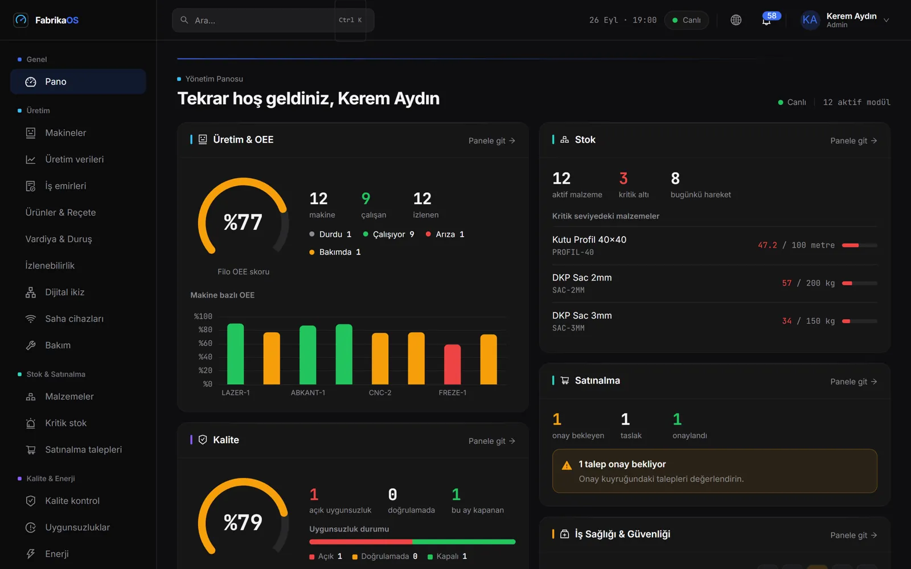
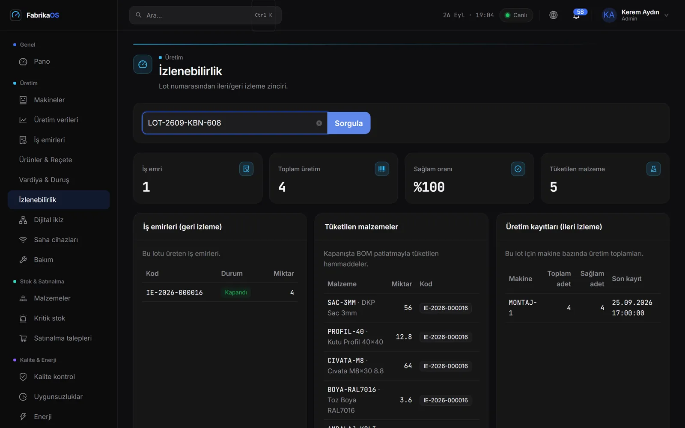
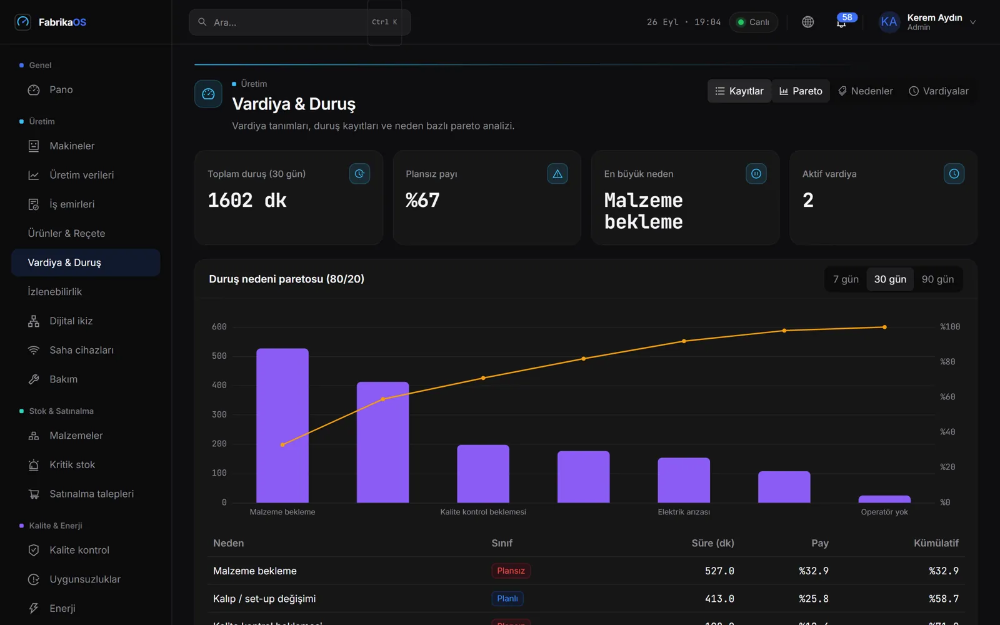
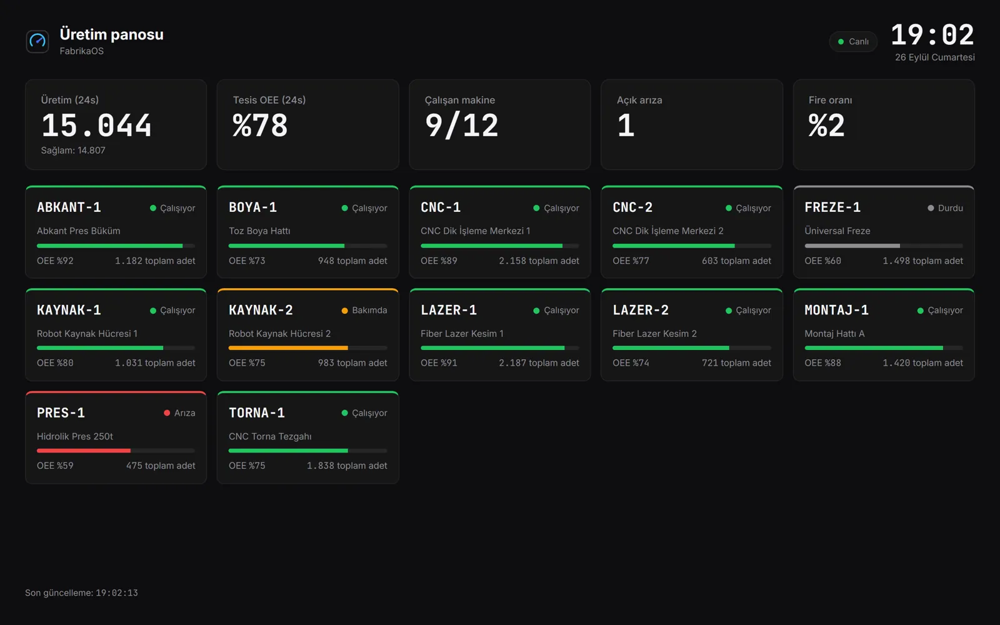
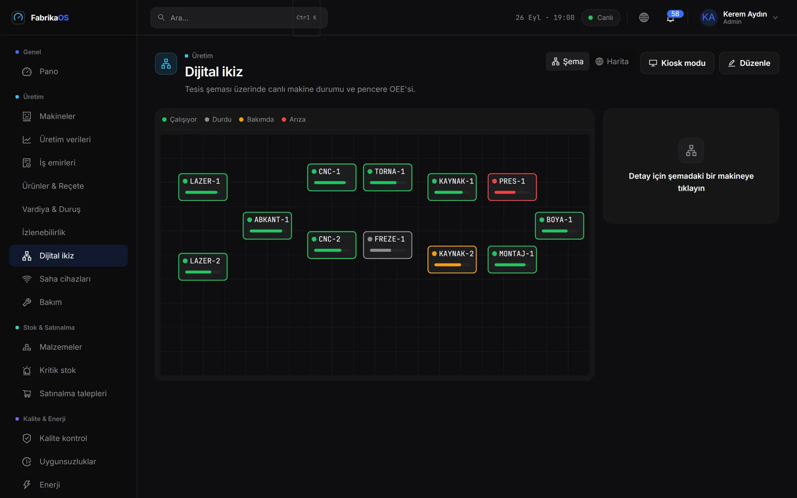
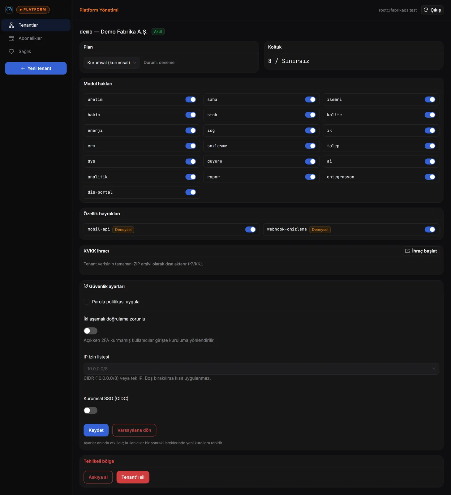
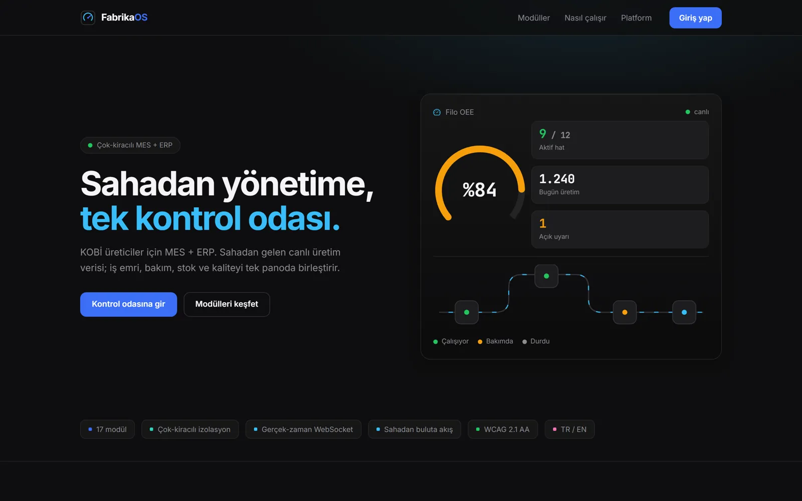
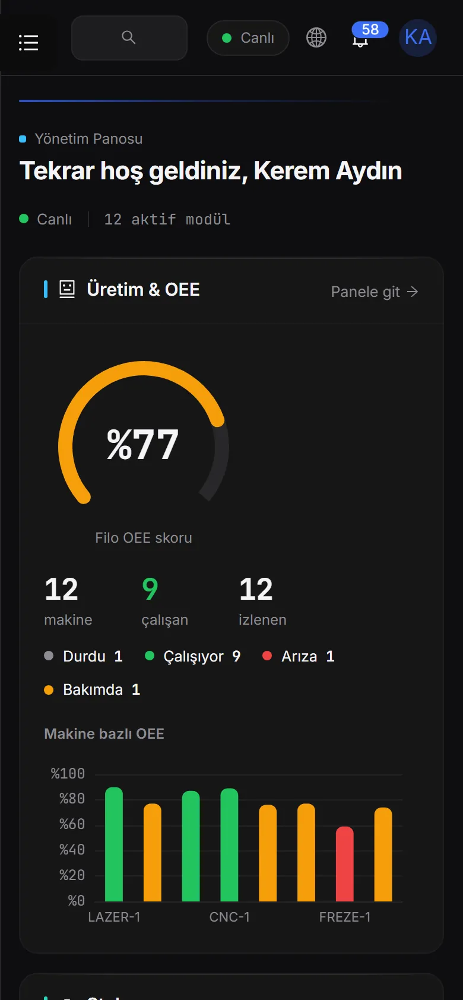

# FabrikaOS


Çok kiracılı (multi-tenant) **MES + ERP hibrit** endüstriyel yönetim platformu (B2B SaaS).
Türkiye'deki orta/büyük ölçekli metal sanayi tesisleri için; KVKK uyumlu, **modül modül
lisanslanabilir**. Operatör bir olayı saniyeler içinde görüp aksiyona dönüştürür; yönetici
dağınık tablolar yerine tek panodan tesisi yönetir.

> Bu depo, `FabrikaOS_Proje_Plani.pdf` şartnamesinin **faz-faz, TDD-disiplinli** uygulamasıdır.
> Tam yol haritası (8 faz / 33 sprint + mobil M0–M5, kabul kriterleri + DoD):
> **[`docs/yol-haritasi.md`](docs/yol-haritasi.md)**. Ürün/marka çerçevesi: [`PRODUCT.md`](PRODUCT.md).

---

## Durum

**Faz 0–4 ✅ · Faz 4B (Vitrin Bütünlüğü) ✅ · Faz 6'dan S23 (kurumsal güvenlik & uyum) ve S24
(MES derinleşmesi) ✅.** S25 (tedarik zinciri) tasarımı hazır ([ADR-0024](docs/adr/0024-tedarik-zinciri-derinlesmesi.md)),
kodlanmadı. Faz 5'in operasyon sprintleri (gözlemlenebilirlik, DR, UAT, GA `v1.0.0`) bilinçli
olarak açık: ürün bir portföy/ürün geliştirme çalışması, canlı müşterisi yok.

| Sprint | Konu | Durum |
|---|---|---|
| S1–S2 | Çekirdek + çok kiracılılık + kimlik/RBAC | ✅ |
| S3–S7 | Üretim/OEE, iş emri/bakım, SPA, ekranlar, gerçek zaman (WebSocket + Redis pub/sub) | ✅ |
| S8 | Edge & Ingestion (MQTT + store-and-forward + cihaz yönetimi) | ✅ |
| S9–S12 | Stok/satınalma, kalite (tam CAPA)/enerji, İSG/İK (KVKK), CRM/sözleşme/talep, DYS (MinIO) | ✅ |
| S13–S15 | AI/ML çekirdeği, analitik + async PDF/Excel rapor, dijital ikiz + kiosk | ✅ |
| S16–S18 | Abonelik/entitlement, platform admin paneli, dış portal + imzalı webhook + API anahtarı | ✅ |
| S-VB | Bildirim merkezi, SLA, operatör eşleştirme, tedarikçi skoru, coğrafi harita, takvim | ✅ |
| S23 | 2FA, OIDC SSO (PKCE), oturum yönetimi, denetim kaydı, KVKK self-servis ihraç/anonimleştirme | ✅ |
| S24 | Vardiya, duruş + Pareto, ürün/reçete (BOM), lot izlenebilirliği, MTBF/MTTR | ✅ |
| S25 | Tedarik zinciri derinleşmesi (depo/lokasyon, sayım, barkod, satınalma siparişi) | 📐 tasarım |
| S19–S22 | Gözlemlenebilirlik, DR, UAT, GA `v1.0.0` | ⬜ |
| S26–S32, M0–M5 | QMS/İK tamamlama, finans, APS, ESG, "FabrikaOS Saha" mobil | ⬜ planlı |

**Kalite kapısı (2026-09-26, CI'da):** **667 backend** testi (birim + gerçek PostgreSQL/
TimescaleDB entegrasyon) + **214 frontend** testi (Vitest + RTL) · `ruff` + `mypy` · `tsc --strict`
+ ESLint + Prettier · `pip-audit` ve `npm audit` (yüksek/kritik açık = kırmızı). Playwright E2E
(canlı güncelleme) yerelde, çalışan yığın ister. Korunan **7 kritik test ailesi**: tenant
izolasyonu, provizyonlama, RBAC, OEE hesaplama, AI çıktısı, migrasyon fan-out, KVKK ihraç/silme.

---

## Ekranlar

| | |
|---|---|
|  |  |
| **Yönetim panosu** — canlı OEE, stok, satınalma, kalite, İSG tek ekranda | **Lot izlenebilirliği** — iş emri → BOM tüketimi → üretim kaydı |
|  |  |
| **Duruş Pareto'su** — kayıp dakikaların %80'ini hangi nedenler yapıyor | **Kiosk** — saha büyük ekranı, kabuksuz, canlı |
|  |  |
| **Dijital ikiz** — tesis şeması üzerinde canlı makine durumu | **Platform paneli** — tenant yaşam döngüsü, modül hakları, KVKK ihracı |
|  |  |
| **Tanıtım sayfası** | **Mobil** — 390 px'de taşmasız kabuk |

---

## Öne çıkan yetenekler

- **Şema-başına-tenant çok kiracılılık** — her fabrika kendi PostgreSQL şemasında; tek-nokta
  `search_path` disiplini + zorunlu izolasyon testleriyle veri sızıntısına yapısal engel.
- **Sahadan canlı OEE** — Edge Gateway (simülatör + OPC-UA/Modbus iskeleti) → MQTT +
  store-and-forward → Ingestion Worker → hypertable → WebSocket ile panoya elle giriş olmadan.
- **Modül modül lisanslama** — 4 plan (deneme/temel/profesyonel/kurumsal) × modül hakları +
  feature flag; koltuk limiti; kapalı modül anında 403 (entitlement ≠ RBAC).
- **Ayrık control-plane** — platform yöneticileri için ayrı kimlik düzlemi: tenant yaşam
  döngüsü, senkron provizyon, KVKK tam-şema ihracı (ZIP → MinIO), platform denetim izi.
- **Dışa entegrasyon** — Stripe-deseni imzalı webhook (retry/backoff, ayrı relay süreci),
  kapsam kısıtlı API anahtarı (`/entegrasyon/*`), firma-kapsamlı dış self-servis portal.
- **Zekâ katmanı** — kestirimci bakım / anomali / OEE / stok tahmini (sürümlü model
  artefaktları), modüller-arası KPI analitiği, async PDF/XLSX raporlama.
- **İmza ekranlar** — dijital ikiz (SVG tesis şeması, sürükle-yerleştir + canlı LED) ve
  kabuksuz kiosk büyük ekranı.
- **KVKK-önce tasarım** — TC maskeleme sunucuda, kişisel veri minimizasyonu, tam-şema ihracı,
  audit trail (kim-ne-ne zaman).

---

## Kapsam — modül haritası (menü bölümü bazında)

Ürün, tenant tarafında **22 iş modülü** + ayrık platform kontrol düzlemi içerir. Ekran-ekran
UI sözleşmesi: [`uiplani.md`](uiplani.md) (UI/UX Master Planı v2).

| Bölüm | Modüller / ekranlar | Öne çıkanlar |
|---|---|---|
| **Genel** | 360° Yönetim Panosu | KPI şeridi + canlı OEE/durum + uyarı akışı |
| **Üretim** | Makineler, Üretim Verileri, İş Emirleri, Dijital İkiz, Saha Cihazları, Bakım | OEE (saf hesap), iş emri durum makinesi + outbox, edge/MQTT ingestion |
| **Stok & Satınalma** | Malzemeler, Stok Hareketleri, Kritik Stok, Satınalma Talepleri | Tutulan bakiye + `FOR UPDATE`, kenar-tetikli `stok.kritik`, çok-kalemli onay (görev ayrımı) |
| **Kalite & Enerji** | Kalite Kontrolleri, Uygunsuzluklar (Tam CAPA), Enerji | 6 aşamalı CAPA durum makinesi, enerji hypertable + continuous aggregate trend |
| **İSG & İK** | İş Kazaları, Risk Değerlendirmeleri, Personeller, İzin Talepleri, Fazla Mesai, Zimmet, Sertifika | 5×5 risk matrisi (sunucuda skor), KVKK TC maskeleme, izin onay akışı (`ik:onay`) |
| **Ticari** | Firmalar (CRM), Sözleşmeler, Talepler, Ticari Pano | Oto kod (`SZ-`/`TL-`), yaklaşan sözleşme kenar-tetiği, durum makineleri |
| **Doküman & Duyuru** | Belgeler (DYS), Duyurular | Sürümlü belge (append-only, **MinIO** tenant-izole nesne), `duyuru.yeni` realtime |
| **Zekâ** | AI Tahminleri, Analitik Pano, Raporlar | Sürümlü model artefaktları, modüller-arası KPI, async rapor (202 → MinIO → indir) |
| **Yönetim** | Kullanıcılar, Abonelik & Modüller, Webhooklar, Dış Portal, Platform Admin | Entitlement matrisi, imzalı webhook + teslimat günlüğü, API anahtarları |

---

## Mimari (özet)

- **Modüler Monolit** · Python 3.12 / FastAPI (async) · SQLAlchemy 2.0 + Alembic
- **Çok kiracılılık:** şema-başına-tenant — `public` (control-plane) + `tenant_<slug>` (her fabrika)
- **Tenant çözümleme:** subdomain (`fabrika-a.fabrikaos.com`) veya `X-Tenant` header → `search_path`
  (tek-nokta dependency; havuza dönmeden sıfırlanır — yanlış uygulama veri sızıntısıdır)
- **Veri:** PostgreSQL 16 + TimescaleDB (hypertable + continuous aggregate) · Redis · MinIO (S3 uyumlu)
- **Gerçek zaman:** FastAPI WebSocket + Redis pub/sub, tenant-kapsamlı kanallar (`tenant:<slug>:olaylar`)
- **Saha:** MQTT + Edge Gateway (simülatör + OPC-UA/Modbus iskeleti) + store-and-forward
- **Entegrasyon:** transactional outbox (`giden_olaylar`) → imzalı webhook relay (ayrı süreç) + API anahtarı
- **Frontend:** React 18 + TypeScript (strict) + Vite 8 + Ant Design v5 (özel koyu tema) + ECharts 6 + TanStack Query
- **Kimlik:** OAuth2/JWT + RBAC, argon2id, rotasyonlu refresh (Redis iptal listesi); ayrık platform kimlik düzlemi

Mimari kararların gerekçeleri: [`docs/adr/`](docs/adr/) (**ADR-0001 … ADR-0024**).

## Dizin yapısı

```
backend/app/
  core/             # config, logging, exceptions, responses (zarf), middleware,
    db/             #   olaylar (outbox), gercekzaman (WS), deps (izin/modul), sorgu
    security/       # parola (argon2id), jwt, rbac, ratelimit, token deposu, redis
  api/              # /api/v1 router toplayıcı + ws (gerçek-zaman WebSocket)
  control_plane/    # public şema: Tenant, Abonelik + provizyonlama
  platform/         # ayrık control-plane: platform yöneticisi, tenant yaşam döngüsü, KVKK ihracı
  kimlik/           # tenant kimlik & RBAC: Kullanici/Rol/Izin + /kimlik, /kullanicilar
  ingestion/        # MQTT → tenant şemasına idempotent yazım (bulut worker)
  modules/          # 22 iş modülü: uretim, isemri, bakim, saha, ikiz, stok, kalite,
                    #   enerji, isg, ik, crm, sozlesme, talep, ticari, dys, duyuru,
                    #   ai, analitik, rapor, abonelik, entegrasyon, dis
backend/migrations/ # Alembic iki ağaç: public/ + tenant/ (fan-out)
backend/scripts/    # provizyon, seed (demo_verisi), entitlement, webhook_relay, bildirim_uretici, platform yönetici
backend/tests/      # birim + entegrasyon testleri (7 kritik test ailesi)
edge/               # Edge Gateway Agent (bağımsız paket: sürücü + store-and-forward + MQTT)
frontend/src/       # api, components, layouts, modules, store, i18n, tema, routes
frontend/e2e/       # Playwright E2E (gerçek-zaman canlı güncelleme)
docs/adr/           # mimari karar kayıtları (0001–0024)
docs/superpowers/   # sprint-başına detaylı tasarım (specs/) + TDD uygulama planları (plans/)
docs/yol-haritasi.md, uiplani.md, mobilplani.md, docs/veri-sozlugu.md
docker-compose.yml  # api, ingestion, bildirim, webhook-relay, db (timescale), redis, minio, mqtt, traefik
```

## Geliştirme ortamı

### Gereksinimler
- **Docker Desktop** (backend yığını için zorunlu)
- **Node.js 22+** (frontend için)
- (Opsiyonel) Python 3.12 — yerel hızlı test/lint için

### Backend (Docker)
```bash
cp .env.example .env
docker compose up --build
```
Yığın API'nin yanında üç arka plan süreci kaldırır: **ingestion** (MQTT → tenant şeması),
**bildirim** (outbox → bildirim merkezi + e-posta) ve **webhook-relay** (outbox → imzalı
teslimat). API olayları yalnızca outbox'a yazar; bu süreçler kapalıysa bildirim ve webhook
akmaz.

- API: http://localhost:8000
- Sağlık: http://localhost:8000/saglik
- Swagger/OpenAPI: http://localhost:8000/docs
- Traefik panosu (dev): http://localhost:8080

### Frontend
```bash
cd frontend
cp .env.example .env        # API taban adresi vb.
npm install
npm run dev                 # http://localhost:5173
```
- Giriş: `/giris` · Uygulama: korunan rotalar (RBAC + entitlement'a göre menü)
- Tasarım önizleme (yalnız DEV, backend gerektirmez): `/onizleme` — KPI / OEE / pano
- Görsel sistem: **nötr antrasit koyu tema, mavi yalnızca vurgu** (bkz. [`DESIGN.md`](DESIGN.md))

### Demo tenant (seed sonrası)
```bash
docker compose run --rm api python -m backend.scripts.demo_verisi   # tekrar-çalıştırılabilir seed
```
İlk çalıştırma tüm modülleri doldurur. Sonraki çalıştırmalar kayıt çoğaltmaz: eksik modülleri
tamamlar, üretim/enerji zaman serisini bugüne getirir ve AI modellerini yeniden eğitir — demo
zamanla "yaşlanmaz" (kiosk ve son-24-saat göstergeleri dolu kalır). Stok tahmin modeli malzeme
başına en az üç günlük gerçek tüketim geçmişi ister; yeni kurulan tenant'ta bu süre dolana
kadar "yetersiz veri" gösterir (stok hareketleri geriye tarihlenemez).
- Tenant: **`demo`** (tüm modüller gerçekçi veriyle dolu) · giriş ekranında **Firma kodu = `demo`**
  (veya `demo.fabrikaos.localhost` subdomain); API isteklerinde `X-Tenant: demo` başlığı.

**Demo hesapları** — hepsi aynı parola: **`Demo1234!`**. Her hesap kendi rolünün RBAC
kısıtlarını sergiler (görev ayrımı, salt-okunur izleme, KVKK erişimi vb.):

| E-posta | Ad Soyad | Rol | Ne gösterir |
|---|---|---|---|
| `admin@demo.test` | (Yönetici) | tüm yetkiler | Tam erişim — tüm modüller ve yönetim |
| `uretim.sefi@demo.test` | Mehmet Yılmaz | `izleyici` | Salt-okunur izleme (pano/üretim) |
| `depo@demo.test` | Ayşe Demir | `depo` | Stok & satınalma talebi oluşturma |
| `satinalma.onay@demo.test` | Hakan Koç | `satinalma-onaylayan` | Satınalma onayı (talep edenden ayrı) |
| `kalite@demo.test` | Elif Şahin | `kalite` | Kalite kontrol + CAPA |
| `ik@demo.test` | Zeynep Arslan | `ik` | İK/personel (KVKK TC maskeli) |
| `ik.yonetici@demo.test` | Murat Çelik | `ik-onaylayan` | İzin onayı (`ik:onay` görev ayrımı) |
| `crm@demo.test` | Deniz Aydın | `crm` | CRM/sözleşme/talep |

**Platform yöneticisi (control-plane, ayrık kimlik düzlemi)** — demo seed'inden bağımsız,
`backend/scripts/platform_yonetici_olustur.py` ile açılır; giriş **`/platform`** rotasından:

| E-posta | Parola | Erişim |
|---|---|---|
| `root@fabrikaos.test` | `Platform12345!` | Tenant yaşam döngüsü, entitlement, KVKK ihracı |

> ⚠️ Bu parolalar yalnızca yerel/demo ortamı içindir; üretimde kullanılmamalıdır.

### Kalite (Python kuruluysa)
Entegrasyon testleri çalışan bir PostgreSQL ister (`fabrikaos_test` veritabanını otomatik oluşturur):
```bash
docker compose up -d db redis
pip install -e ".[dev]"
ruff check backend && ruff format --check backend
mypy
pytest                       # TEST_DATABASE_URL ile override edilebilir (CI)
```
Docker içinde: `docker compose run --rm api pytest`

Frontend:
```bash
cd frontend
npm run lint && npm run typecheck && npm test
npm run test:e2e            # Playwright E2E — çalışan yığın + seed'li tenant ister (E2E_BASE/E2E_API ile origin)
```

## Veritabanı, migrasyon ve provizyonlama

Çok kiracılılık **şema-başına-tenant**'tır: control-plane `public`, her fabrika `tenant_<slug>`.
Migrasyonlar iki Alembic ağacında tutulur ve **fan-out** edilir (bkz.
[`docs/adr/0004-*`](docs/adr/0004-alembic-fan-out.md)).

```bash
# Control-plane (public) şemasını yükselt
python -m alembic --name public upgrade head

# Tüm aktif tenant şemalarına fan-out
python -m alembic --name tenant upgrade head

# Yeni tenant provizyonla (public kayıt + şema + migrate + seed; idempotent)
python -c "import asyncio; from app.control_plane.provizyon import tenant_provizyonla; \
asyncio.run(tenant_provizyonla(slug='fabrika-a', ad='Fabrika A', \
admin_eposta='admin@fabrika-a.test', admin_parola='Parola123!'))"
```

> **Not (S16 dersi):** Yeni bir izin kodu eski tenant'lara otomatik inmez — entitlement/izin
> güncellemesi tüm aktif tenant'larda idempotent olarak yeniden koşulur. Tenant yaşam döngüsü
> (provizyon/askıya-al/sil/KVKK ihracı) artık **Platform Admin Paneli** üstünden de yönetilir.

## Saha & Ingestion (S8)

Sahadan otomatik veri akışı (bkz. [`docs/adr/0010-*`](docs/adr/0010-edge-ingestion-mqtt.md)).
`docker compose up -d db redis mqtt` sonrası:

```bash
# Bulut Ingestion Worker (MQTT abonesi → tenant şemasına idempotent yazım)
MQTT_HOST=localhost python -m app.ingestion.worker

# Edge Gateway Agent (simülatör PLC → store-and-forward → MQTT)
EDGE_BROKER_HOST=localhost EDGE_TENANT_SLUG=<slug> EDGE_CIHAZ_KOD=GW-1 \
  python -m edge.agent
```

Cihaz önce kaydedilir (`POST /api/v1/saha/cihazlar`, `saha:yaz`) ve `makine_kod`'lar
`makineler`'de var olmalıdır. Ölçümler `uretim_verileri`'ne yazılır → OEE panosu elle giriş
olmadan güncellenir. REST/CSV ile de gönderilebilir: `POST /api/v1/saha/olcumler`
(+`/csv`, `edge` izni).

## Dış entegrasyon (S18)

- **Webhook:** `POST /api/v1/webhooklar` ile abonelik (URL + olay türleri + `whs_` gizli anahtar,
  bir-kez döner/maskeli). Outbox → imzalı teslimat (`X-FabrikaOS-Signature: t=..,v1=..`,
  Stripe deseni), backoff `1dk→6sa` / 6 deneme, teslimat günlüğü + yeniden-dene. Relay **ayrı
  süreç**: `python -m backend.scripts.webhook_relay --tek-tur`.
- **API anahtarı:** `fos_` anahtar (SHA-256 özet, kapsam beyaz-listesi); başlık `X-API-Anahtar`;
  salt-okunur `/api/v1/entegrasyon/*` (stok bakiyeleri, satınalma talepleri, üretim özeti).
- **Dış portal:** rol `dis-panel` + `kullanici.firma_id`; `/api/v1/dis/*` firma-kapsamlı
  self-servis (kabuksuz `/dis` arayüzü).

## Konvansiyonlar
- **Identifier:** Türkçe-ASCII (ç/ş/ı/ğ/ö/ü yok) — bkz. [`docs/veri-sozlugu.md`](docs/veri-sozlugu.md)
- **API:** `/api/v1`, kaynak-odaklı çoğul Türkçe uçlar, yanıt zarfı `{success, message, data, meta}`;
  sayfalama `?sayfa=&adet=&siralama=&yon=&arama=`; POST için opsiyonel `Idempotency-Key`
- **RBAC:** Türkçe `kaynak:eylem` izin sözlüğü; her uçta `Depends(izin_gerekli("..."))`;
  entitlement kapısı `Depends(modul_gerekli("..."))`
- **Commit:** Conventional Commits · **Dallanma:** trunk-based · **Sürüm:** SemVer
- **Mimari kararlar:** [`docs/adr/NNNN-*.md`](docs/adr/) (**0001–0024**)

## Dokümantasyon

| Belge | İçerik |
|---|---|
| [`docs/yol-haritasi.md`](docs/yol-haritasi.md) | 8 faz / 33 sprint (+ mobil) — kapsam, kabul kriteri, DoD, geçiş kapıları |
| [`PRODUCT.md`](PRODUCT.md) | Ürün amacı, kullanıcılar, marka kişiliği, tasarım ilkeleri |
| [`DESIGN.md`](DESIGN.md) | Görsel sistem — token'lar, hat rengi kimliği, bileşen desenleri |
| [`uiplani.md`](uiplani.md) | UI/UX Master Planı v2 — tam site haritası + modül-modül ekran spec'leri |
| [`mobilplani.md`](mobilplani.md) | "FabrikaOS Saha" mobil master planı (Faz 8 / M0–M5) |
| [`docs/adr/`](docs/adr/) | Mimari karar kayıtları (0001–0024) |
| [`docs/superpowers/specs/`](docs/superpowers/specs/) | Sprint-başına kodlanmaya hazır tasarım belgeleri |
| [`docs/veri-sozlugu.md`](docs/veri-sozlugu.md) | Veri sözlüğü — kavram ↔ identifier ↔ tablo/kolon |

## Yol haritası

**Faz 0** Temel → **Faz 1** MVP → **Faz 2** Saha & Modüller → **Faz 3** Zekâ →
**Faz 4** Lisanslama & Dış Entegrasyon → **Faz 4B** Vitrin Bütünlüğü (köprü) →
**Faz 5** Operasyon & GA (`v1.0.0`) → **Faz 6** Kurumsal Derinleşme (`v2.0` adayı) →
**Faz 7** Yeni Satılabilir Modüller → **Faz 8** Mobil Saha.

Sprint-sprint kapsam, kabul kriterleri, DoD ve geçiş kapıları: **[`docs/yol-haritasi.md`](docs/yol-haritasi.md)**.

## Nasıl geliştirildi

FabrikaOS baştan sona yapay zekâ ile, ama disiplinle kuruldu: 173 commit'in 172'si Claude ortak
yazarlı. Hız modelden, doğruluk süreçten geldi:

- **Şartname → ADR → spec → plan → TDD.** Her sprint bir tasarım belgesiyle
  ([`docs/superpowers/specs/`](docs/superpowers/specs/)) ve adım adım uygulama planıyla
  ([`plans/`](docs/superpowers/plans/)) başladı ve TDD ile uygulandı; mimari kararlar 24 ADR'de
  gerekçesiyle kayıtlı.
- **Riskli kurallar testle kilitlendi.** Tenant izolasyonu, `search_path` sızıntısı, RBAC görev
  ayrımı, KVKK imha sırası gibi "yanlış olursa veri sızar" kuralları için ayrı test aileleri var;
  bir sözleşme testi, KVKK artefaktına paylaşılabilir (presigned) URL yüzeyi eklenirse kırılır.
- **Model çıktısı denetlendi.** Her sprint sonu inceleme turu yapıldı; bulunan hatalar
  (webhook URL'sinde SSRF önek hilesi, yetki restorasyonu, imha sırası) ayrı commit'lerle
  kapatıldı.
- **2026-09 denetimi** ürünü yeniden ölçtü ve şunları kapattı: CI 07-30'dan beri kırmızıydı
  (KVKK testleri gerçek MinIO'ya çıkıyordu → hermetik); beklenmeyen 500'ler CORS başlığı olmadan
  dönüp tarayıcıda "CORS hatası" görünüyordu; WebSocket token'ı erişim loguna düz metin
  düşüyordu; mobilde her sayfa 241 px yatay taşıyordu; bildirim ve webhook süreçleri
  compose'da yoktu; demo verisi yeni modülleri doldurmuyor ve birkaç günde "yaşlanıyordu";
  geliştirme bağımlılıklarında 10 yüksek/kritik açık vardı (Vite 8, Vitest 5, ECharts 6); anomali
  ekranının her açılışı tüm yetkililere yeni bir bildirim gönderiyordu.

## Güvenlik notları

- Kalan bilinen açık: `react-router` 6 için iki orta seviye uyarı (backslash ile açık yönlendirme,
  SSR hidrasyonu). Uygulama SPA'dır (SSR yok) ve tüm yönlendirmeler sabit iç yollara gider
  (`/pano`, `/giris`); kullanıcı kontrollü hedef yoktur. Düzeltme v7'ye geçiş ister, planlıdır.
- WebSocket kimliği tarayıcı kısıtı gereği sorgu parametresinde taşınır; log akışında
  `token=` değerleri maskelenir.

## Lisans

Tescilli (proprietary) — tüm hakları saklıdır. Bu depo bir portföy/ürün geliştirme çalışmasıdır;
harici kullanım/çoğaltma yazılı izne tabidir.
